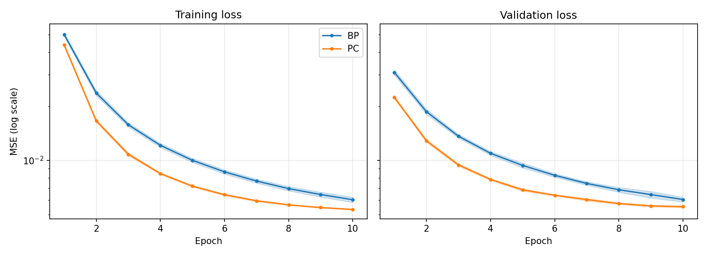
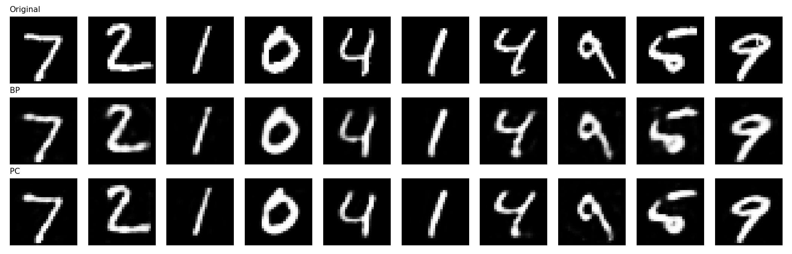
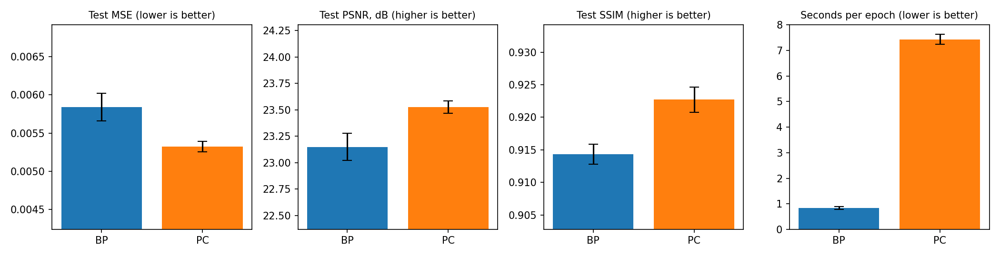

# Backpropagation vs. Predictive Coding for MNIST Image Reconstruction

A small, controlled comparison of two ways to train the same neural network: standard **backpropagation (BP)** and **predictive coding (PC)**, a local, energy-based learning rule inspired by how the brain may learn. Both are trained as autoencoders on MNIST, and everything except the learning algorithm is held fixed.

Everything runs in a single Google Colab notebook (`bp_vs_pc_mnist_reconstruction.ipynb`) on a free T4 GPU in about 10 minutes.

## Key findings

- PC reached a slightly **better test reconstruction** than BP under the same architecture, initialization, optimizer, and number of epochs.
- The difference is small (about 9% lower MSE) but consistent: every PC seed beat every BP seed (paired t-test, p = 0.008).
- PC is about **9x slower per epoch**, because each batch needs an iterative inference loop before the weight update.

## Setup

| Item | Choice |
|---|---|
| Dataset | MNIST, pixels scaled to [0, 1], flattened to 784 |
| Split | 55,000 train / 5,000 validation / 10,000 test |
| Architecture | 784 → 256 → 64 → 256 → 784 (435,536 parameters) |
| Activations | Tanh (hidden), Sigmoid (output) |
| Initialization | Xavier uniform weights, zero biases (same seed gives identical starting weights for BP and PC) |
| Optimizer | Adam, learning rate 1e-3 for both methods |
| Batch size / epochs | 128 / 10 |
| Seeds | 5 (0 to 4) |
| Hardware | Google Colab, Tesla T4 |

The learning rate was chosen for each method on the validation set from the same 3-value grid (5e-4, 1e-3, 2e-3), so both methods had an equal tuning budget. Both picked 1e-3.

## Methods

### Backpropagation
A standard feed-forward autoencoder trained end to end with an MSE loss.

### Predictive coding
The same network is treated as a hierarchy of states x₀ ... x₄, where each layer predicts the next:

- Prediction: μₗ = f(Wₗ₋₁ xₗ₋₁ + bₗ₋₁)
- Prediction error: εₗ = xₗ − μₗ
- Energy: F = ½ Σ ‖εₗ‖²

For each training batch:

1. **Clamp** the input layer x₀ and the output layer x₄ to the image.
2. **Initialize** the hidden states (x₁, x₂, x₃) with a feed-forward pass.
3. **Inference:** update the hidden states by gradient descent on F for T = 20 steps with inference rate 0.1.
4. **Learning:** update the weights with a local rule (prediction error times presynaptic activity, scaled by the activation derivative), applied through the same Adam optimizer used for BP.

At test time only the input is clamped. The feed-forward state is already the energy minimum, so the PC reconstruction equals the network's forward pass. This means any gain comes from the training procedure, not from extra inference at test time.

### Sanity check
PC weight updates were compared with BP gradients on a batch of 256 training images (cosine similarity per layer, layers 0 to 3):

| Inference steps | Layer 0 | Layer 1 | Layer 2 | Layer 3 |
|---|---|---|---|---|
| T = 20 | 0.97 | 0.97 | 0.95 | 0.75 |
| T = 100 | 0.97 | 0.96 | 0.72 | 0.45 |

All values are clearly positive, so the implementation is consistent with BP, but the updates are not identical. With input and output both fully clamped, running inference longer spreads the error across layers and moves the updates further from the BP gradient. T = 20 was kept.

## Results

Test set, mean ± standard deviation over 5 seeds:

| Method | MSE (lower is better) | PSNR, dB | SSIM | Seconds per epoch |
|---|---|---|---|---|
| BP | 0.00584 ± 0.00018 | 23.15 ± 0.13 | 0.9143 ± 0.0015 | 0.83 ± 0.06 |
| PC | **0.00532 ± 0.00007** | **23.53 ± 0.06** | **0.9227 ± 0.0019** | 7.44 ± 0.20 |

Paired t-test on test MSE (BP vs. PC): t = 4.90, p = 0.008. PC was 8.9x slower per epoch. Epoch times exclude the first epoch (GPU warm-up).

### Figures

**Training and validation loss** (mean ± std over seeds; log scale)



**Reconstructions on test images** (original, BP, PC; seed 0 models)



**Metric comparison** (the first three panels use a truncated y-axis to make the small gap visible)



## Discussion

PC reconstructs slightly better and with lower variance across seeds, but the gap is small, and the two methods' outputs look visually very similar. The cost is compute: each PC step requires an inference loop, which makes it far slower than BP on a GPU built for backpropagation. In exchange, PC's updates are local, using only information from neighboring layers, which makes it more biologically plausible and potentially attractive for parallel or neuromorphic hardware.

## Limitations

- **Equal epochs, not equal compute.** BP's loss was still decreasing at epoch 10. With the same wall-clock time, BP could train for roughly 9x more epochs and might close or reverse the gap. This comparison does not test that.
- **Small tuning budget.** Only the learning rate was tuned (3 values, one seed per method). The number of inference steps, the inference rate, batch size, and architecture were fixed, so a wider search could change the ranking.
- **PC is not just BP in disguise here.** The gradient check shows PC updates are strongly aligned with BP gradients but not identical, which may partly explain why PC converges to a different solution. This was not investigated further.
- **Narrow scope.** One dataset (MNIST), fully connected networks only, a reconstruction task only, and 5 seeds.

## Reproducing the results

1. Open a new Google Colab notebook and set **Runtime → Change runtime type → T4 GPU**.
2. Run the cells in this order: setup and data, model and metrics, BP training, PC training and gradient check, learning-rate tuning, final 5-seed runs, plots.
3. The figures are saved as `fig1_loss_curves.png`, `fig2_reconstructions.png`, and `fig3_metrics.png`.

MNIST is downloaded automatically by `torchvision`. Seeds are fixed, so results should reproduce closely, though small GPU nondeterminism can cause tiny differences.

**Requirements:** Python 3, PyTorch, torchvision, NumPy, SciPy, Matplotlib (all preinstalled on Colab).

## Repository contents

```
.
├── bp_vs_pc_mnist_reconstruction.ipynb   # full code
├── fig1_loss_curves.png
├── fig2_reconstructions.png
├── fig3_metrics.png
└── README.md
```

## Future work

- Equal wall-clock (or equal FLOP) comparison
- Convolutional predictive coding
- Harder datasets such as Fashion-MNIST and CIFAR-10
- Faster PC variants that reduce the cost of inference

## Author

*GihonAbyssiniaGO_aah*
